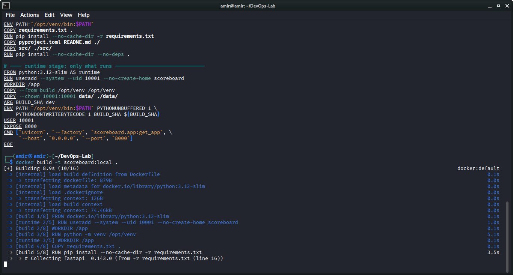
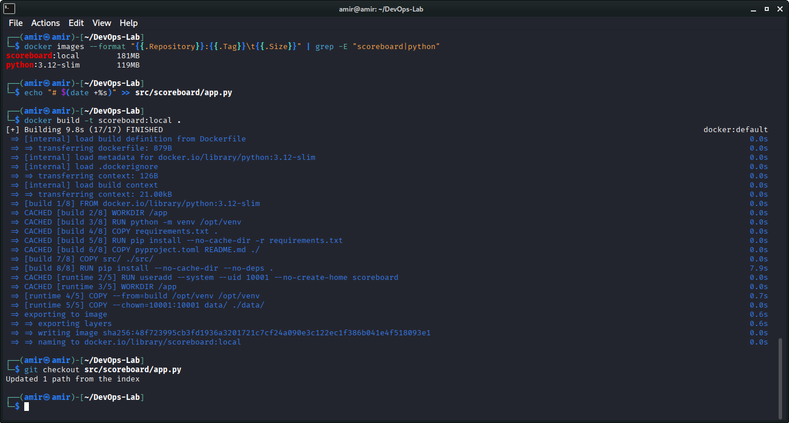
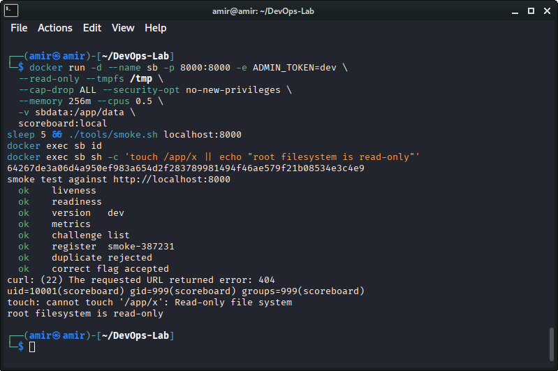
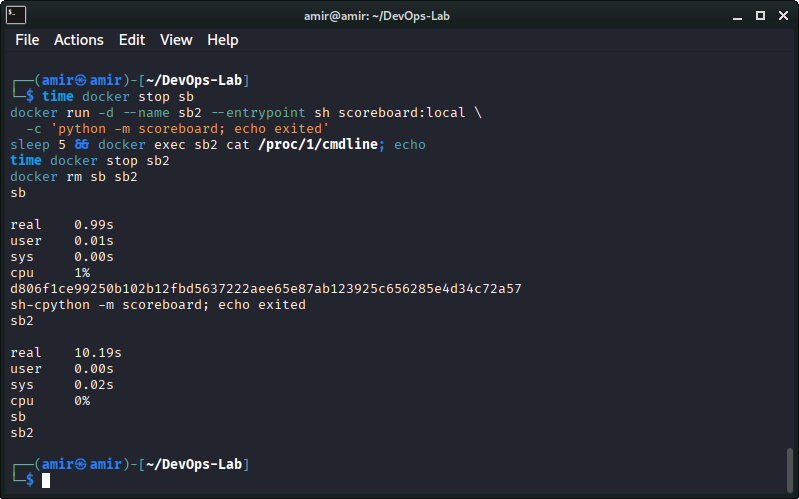
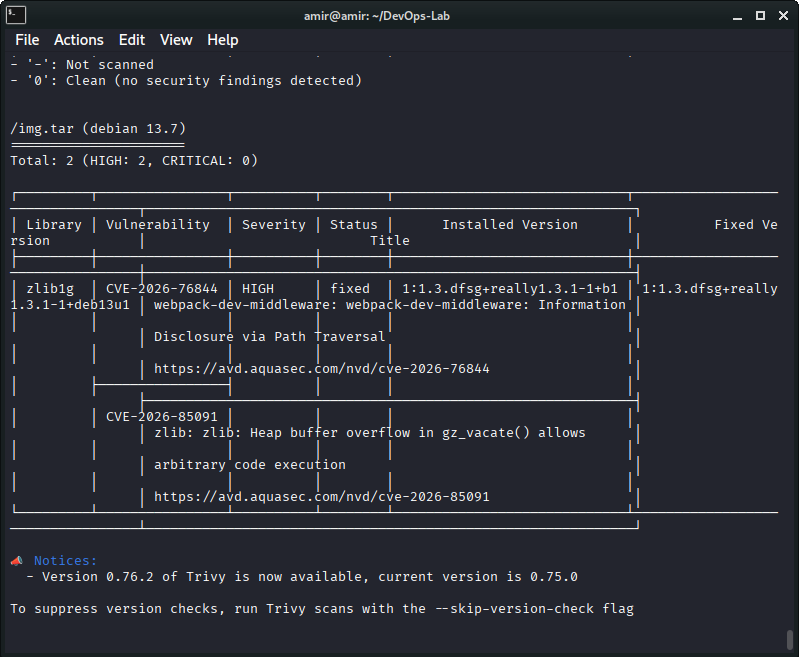
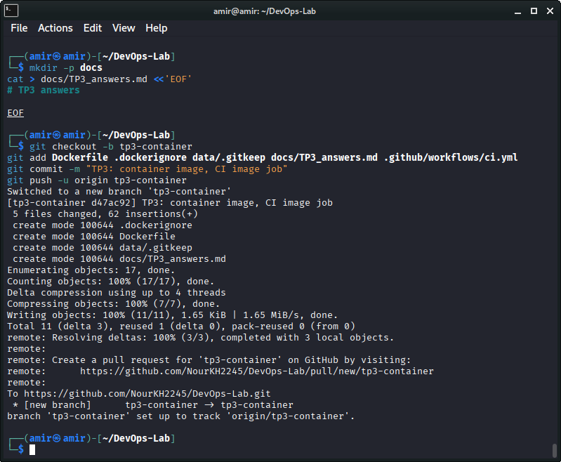

# TP3 answers

**Team members:**
- Amir Elcharif Mohammedi
- Koraichi Sondous Hiba
- Khelloufi Nour
- Benmecheri Ahmed Ryad

**Repository URL:** https://github.com/NourKH2245/DevOps-Lab

## Exercise 1

(a) scoreboard:local is 181MB and python:3.12-slim is 119MB. So my image is around 62MB bigger than the base, I think it's the python packages in the venv (fastapi, sqlalchemy, uvicorn...).

(b) In the build stage there is the source code folder src, with pyproject.toml, README.md and requirements.txt. Also the build layers (the pip install steps). In the runtime image none of this is there, when I did ls on /app I saw only the data folder. Only the venv is copied from the build stage.
One thing I noticed, pip is still in the final image because both stages use the same python slim base, so I can't say pip is removed.

(c) Without the source code and project files, an attacker inside the container has less things to read and to modify. And with the build layers not shipped the image is smaller, so there are less files and packages that can have vulnerabilities.

(d) Because of the cache. The requirements almost never change but the code changes a lot. In the second build, after I changed the app.py, the steps WORKDIR, venv creation, copy of requirements.txt, pip install of requirements and copy of pyproject and README all said CACHED. Only the copy of src and the last pip install ran again. First build took 75.8s (pip install alone was 51s) and the second took 9.8s. If src was copied first, every small change in code would reinstall all the dependencies.

## Exercise 2

(a) The volume sbdata mounted on /app/data. It's writable so sqlite can write its file there even if the root filesystem is read-only. The tmpfs on /tmp is also writable for temporary files.

(b) With a named volume docker creates it and it gets the owner of the folder from the image. In my image /app/data belongs to 10001 (I saw it in the ls) and the app runs with this uid, so it can write. A host folder like $PWD/data belongs to my user, and uid 10001 in the container usually can't write in it, we get permission denied. Also the database stays out of my git folder.

(c) First option is cap-drop ALL. The attacker doesn't have linux capabilities anymore so he can't do root things like changing the owner of files, using raw sockets or binding ports below 1024.
Second one is no-new-privileges. The attacker can't get more privileges than the process already has, so for example a setuid binary in the container doesn't help him to become more powerful.

The id command gave uid=10001(scoreboard), so not root, and touch on /app/x gave read-only file system.

## Exercise 3

(a) docker stop sb took 0.99s and docker stop sb2 took 10.19s.

(b) In sb uvicorn is PID 1 so it gets the SIGTERM from docker stop directly, and it stops cleanly in about one second. In sb2 the shell is PID 1 (cat /proc/1/cmdline shows sh -c python -m scoreboard; echo exited). The shell doesn't forward the SIGTERM to python and PID 1 has no default handling of signals, so it is ignored. Docker waits 10 seconds and then sends SIGKILL. That's why we have 10s.

(c) For each replica we lose about 9 more seconds, so with twenty replicas it's around 180s, 3 minutes more for the update. And also the replicas are killed with SIGKILL so the requests in progress are cut and users can get errors.

## Exercise 4

(a) Trivy found 2 findings, both HIGH and no CRITICAL. Both are in the same package, zlib1g, on debian 13.7. They are CVE-2026-76844 and CVE-2026-85091, and a fixed version exists (deb13u1). The title of the first one talks about webpack-dev-middleware which looks strange for zlib, but I just wrote what the scanner printed. The python packages all had 0.

(b) pip-audit only checks the python packages from requirements.txt. Trivy checks the whole image including the OS packages that come with the Debian base image, like zlib1g. So the problem is not in my python dependencies, it's in the base image.

(c) We pin the scanner so the same image gives the same result every time, a new version could change the results without any change in my code. It's also safer because a floating version can run new code in the pipeline that nobody checked.

## Exercise 5

(a) The commit goes like this. First github gives the hash to the workflow as github.sha. Then in the image job it's passed with build-args BUILD_SHA. In the Dockerfile, ARG BUILD_SHA receives it and ENV saves it in the image. When the container runs, the app reads the environment variable BUILD_SHA and the endpoint /version shows it in the commit field. I tested with the published image and the commit was the same as the tag.

(b) If both images have the tag latest we can't know which version is really running, because latest is just a name that moves. Also a server can keep an old latest in cache and not pull the new one, so two "same" images are different code. And rollback is not possible because the old image lost the name.

## Command execution evidence

Screenshots of the commands I ran for this lab are stored in docs/screenshots/lab3:

- 01-docker-build.png: first build of the image (multi-stage Dockerfile).
- 02-cache-rebuild.png: second build after changing one line of code, with the CACHED steps.
- 03-hardened-run.png: container started with the restrictions, smoke test, user id and read-only filesystem test.
- 04-sigterm-stop-times.png: stop time with uvicorn as PID 1 and with a shell as PID 1.
- 05-trivy-scan.png: Trivy scan of the saved image (2 HIGH findings in zlib1g).
- 06-git-push-branch.png: branch created, commit and push of the Dockerfile and the CI job.
